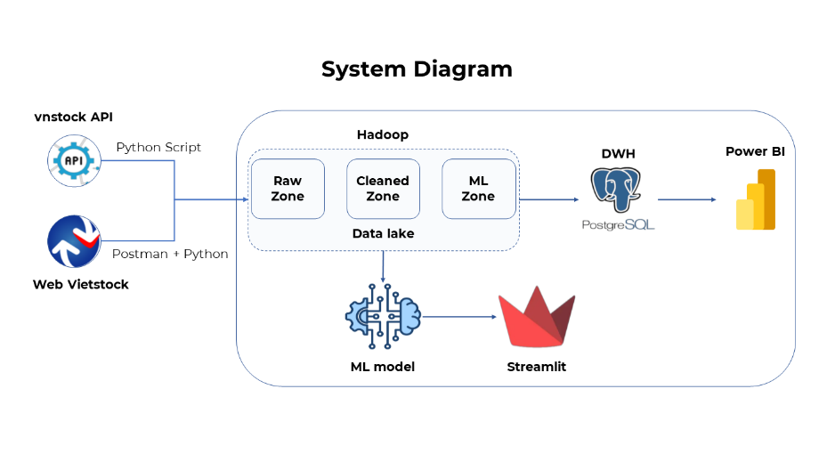
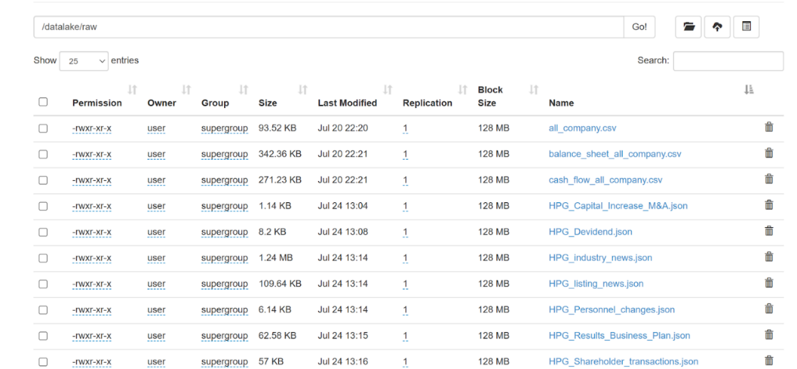
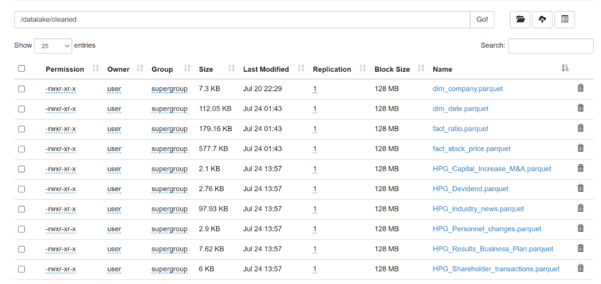
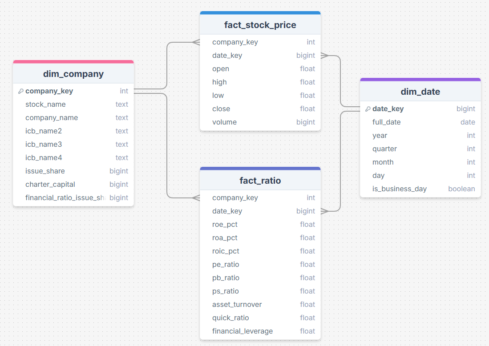

# Stock Market Big Data Pipeline

Capstone project of the **Big Data & Analytics** course at **Samsung Innovation Campus** (06/2025 – 07/2025), built by team *SmallData* (5 members).

The project collects Vietnamese stock market data from several sources, stores it in a **Hadoop HDFS data lake**, transforms it into a **star schema** and serves it to a **Power BI** dashboard. The data then feeds stock price forecasting and news sentiment models.



## Architecture

| Layer | What happens | Tech |
|---|---|---|
| **Ingestion** | Pull market and company data for 15 listed companies (HPG, HSG, DGC, GVR, VNM, FPT, MWG, SSI, CTG, BID, VGS, VGL, NKG, TVN, GDA) and crawl news/events from Vietstock with pagination and error handling | Python, vnstock API, REST/web scraping |
| **Raw Zone** | Land raw data as-is in HDFS `/datalake/raw` | Hadoop HDFS (WebHDFS), JSON/CSV/Parquet |
| **Cleaned Zone** | Validate schemas (required-column checks), standardize columns, cast types, convert to Parquet in `/datalake/cleaned` | Pandas, PyArrow, fsspec |
| **Data Warehouse** | Star schema: `dim_company`, `dim_date`, `fact_stock_price`, `fact_ratio` (34 financial ratios) | PostgreSQL |
| **BI** | Overview and detail pages: price trend, volume, trading value, ROE, ROA, P/E, P/B, peer comparison | Power BI, DAX |
| **ML** | LSTM + XGBoost stacked with Random Forest for HPG/HSG price forecasting; PhoBERT news sentiment (~76% accuracy) | Python, Streamlit |

### Data collected

- **vnstock (VCI source):** listed companies, company overview, daily OHLCV prices (2015 – 07/2025), quarterly balance sheet, income statement, cash flow and financial ratios.
- **Vietstock:** industry news; company news (business results, dividends, capital increase/M&A, shareholder transactions, personnel changes); event calendars for the company and its industry peers.

### Data lake on HDFS

| Raw Zone | Cleaned Zone |
|---|---|
|  |  |

### Star schema



## Repository structure

```
notebooks/
  01_crawl_and_ingest.ipynb        # crawl vnstock + Vietstock, write to HDFS raw zone
  02_transform_to_star_schema.ipynb  # read raw zone, validate/transform, build dim/fact tables, write cleaned zone
dashboard/
  stock_dashboard_template.pbit    # Power BI template (star schema model + DAX measures)
docs/images/                       # architecture, schema and HDFS screenshots
```

The ML models and the Streamlit app are not included in this repository.

## How to run

1. Start a Hadoop cluster with WebHDFS enabled (the notebooks use `http://localhost:9870`, user `user`).
2. Install dependencies:
   ```bash
   pip install -r requirements.txt
   ```
3. Vietstock endpoints need a browser session. Copy your own cookie and `__RequestVerificationToken` from the browser and set them as environment variables:
   ```bash
   export VIETSTOCK_COOKIE="..."
   export VIETSTOCK_TOKEN="..."
   ```
4. Run `01_crawl_and_ingest.ipynb`, then `02_transform_to_star_schema.ipynb`.
5. Open the `.pbit` template in Power BI Desktop and point it to your data source.

